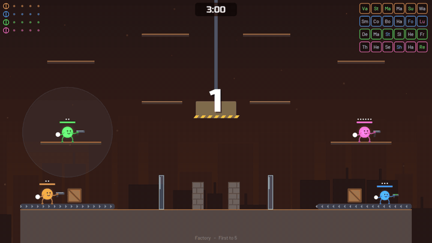
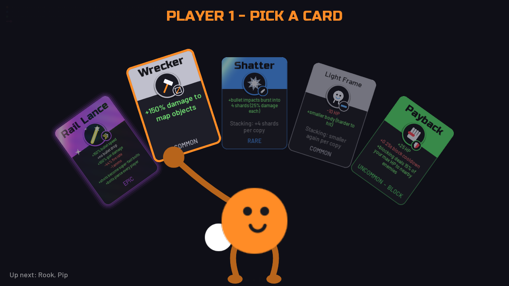
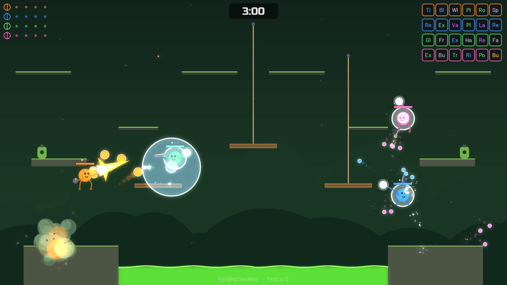
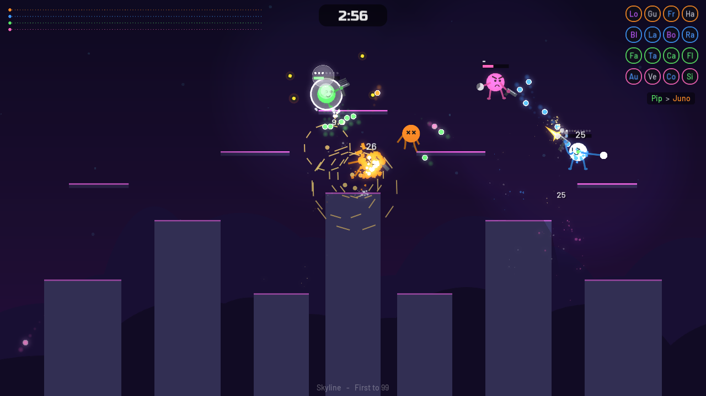
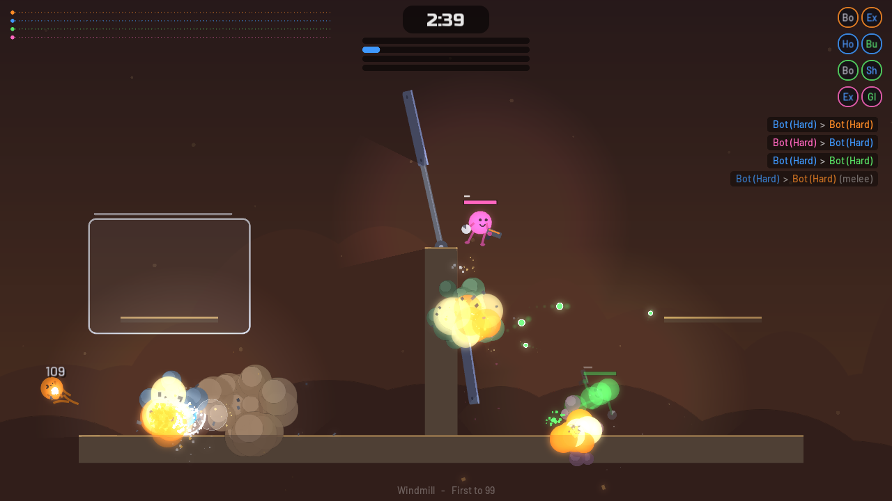
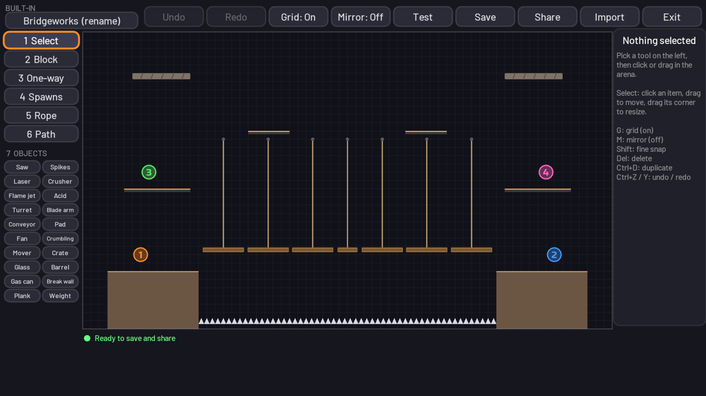
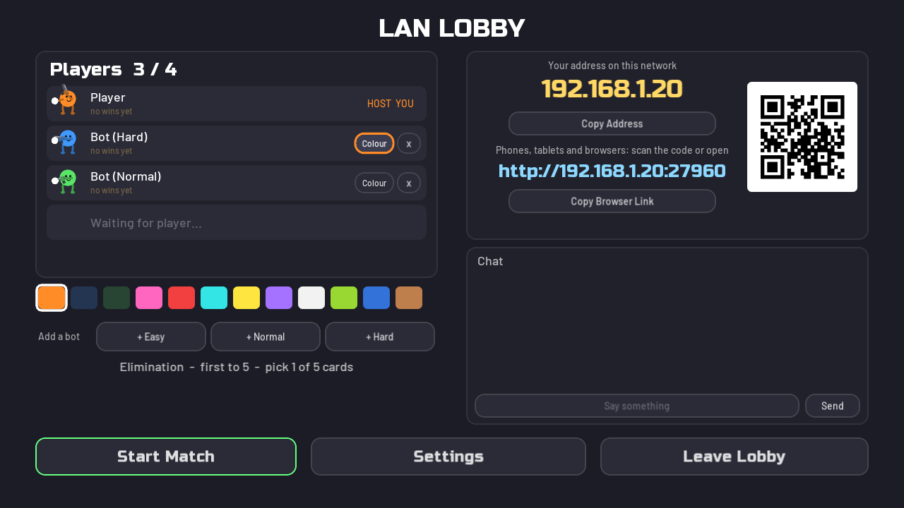
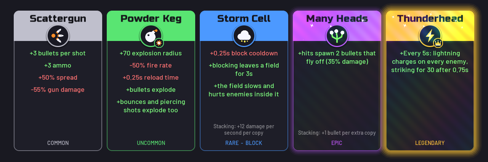
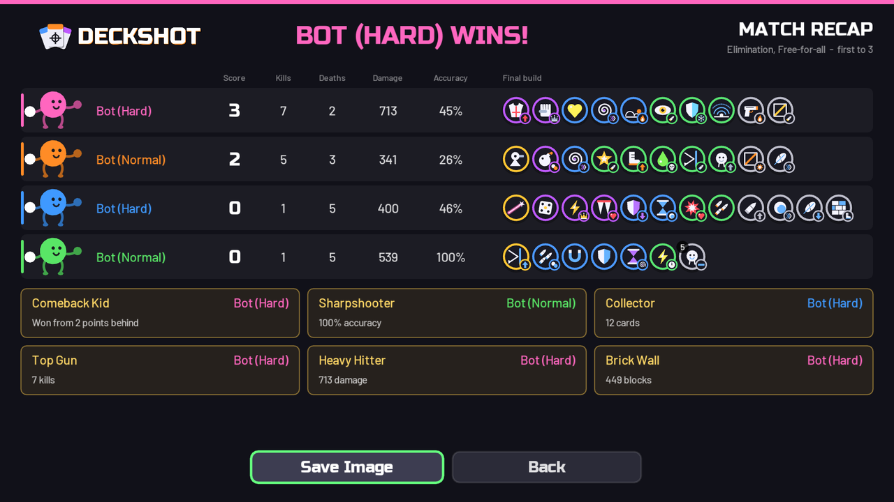

<p align="center">
  
</p>

<h3 align="center">Lose a round. Pick a card. Come back stronger.</h3>

<p align="center">
  A chaotic 2-4 player arena shooter where every loss makes you weirder and more dangerous.<br>
  Couch play, bots, Steam, LAN, and phones in the same match.
</p>

<p align="center">
  <a href="https://distorbed678.github.io/deckshot/play/"></a>
  <a href="../../releases/latest"></a>
</p>

<p align="center">
  
</p>

## Why you'll keep saying "one more round"

- **116 upgrade cards that all stack.** Bouncing rockets, black holes, lightning on block, orbiting shields, a turret on your shoulder. Take the same card three times and find out what happens.
- **Cards that really combine.** Explosive + Bouncy makes every bounce explode. Poison spreads through your blasts and shards. Nothing is scripted as a special pair.
- **Losers get stronger.** Win 2 sub-rounds to take a point, then everyone else picks a card, so no match is over until it's over.
- **Physics runs the whole game.** Crates tumble, walls topple, ropes sag and snap a segment at a time, and everything is simulated with Box2D. Shove cover around, cut something down onto your opponent, or hide behind a wall: blasts and presence cards can't reach through it.
- **50 arenas built around physics**, with rope bridges, spinning arms, rails, crushers, flame jets, liquids you can float crates on, and blocks that break, burn or collapse.
- **Elimination, King of the Hill or Juggernaut**, free-for-all or teams picked by colour, with a sudden-death barrier that ends the stalling. In Juggernaut, one over-powered player takes on everyone, and whoever brings them down takes over.
- **Vote on the next map, ban the card you hate, chat with your friends.**
- **A recap after every match** with everyone's stats, builds and awards, saved as an image to show off, and you can save the whole match as a replay to watch again.
- **Unlock about 60 hats, eyes, mouths and details** through 44 achievements.
- **Voice chat** over Steam and LAN, with push-to-talk or open mic.
- **Make your own** maps and cards. The map editor has swipe painting, rotation and slopes, groups, colours and live physics testing, and you can share what you make with a code.
- **Community browser:** download maps and custom cards other players have added, or send in your own through GitHub (desktop versions).

<table>
  <tr>
    <td></td>
    <td></td>
  </tr>
  <tr>
    <td></td>
    <td></td>
  </tr>
  <tr>
    <td></td>
    <td></td>
  </tr>
  <tr>
    <td></td>
    <td></td>
  </tr>
</table>

## Play it

### Linux (AppImage)

1. Download `Deckshot-x86_64.AppImage` (see [Releases](../../releases), or [build it yourself](#for-developers)).
2. Make it executable and run it:
   ```sh
   chmod +x Deckshot-x86_64.AppImage
   ./Deckshot-x86_64.AppImage
   ```
   If it fails to start because FUSE is missing, run `./Deckshot-x86_64.AppImage --appimage-extract-and-run` instead.

### Windows

1. Download `Deckshot-windows-x64.zip` (see [Releases](../../releases), or [build it yourself](#for-developers)).
2. Unzip it anywhere and run `Deckshot\Deckshot.exe`. Keep the DLLs next to the exe.

### Browser

Open **https://distorbed678.github.io/deckshot/play/**. Nothing to install. Play against bots, or share the keyboard. Gamepads work, and on a phone or tablet the touch controls appear when you touch the screen (turn it sideways; "Add to Home Screen" gives a full-screen app). Settings are saved in your browser. Steam play, saved replays, the Community browser and voice chat aren't available in the browser. To join a LAN game from a browser or phone, open the address (or scan the QR code) the desktop host's lobby shows (see [LAN play](#lan-play)).

On Windows and Linux the game checks for new versions and offers a one-click update from the main menu.

## Controls

All keys can be rebound in **Settings → Controls**, and **How to Play** in the game shows every scheme. Defaults:

| | Move | Jump | Aim | Fire | Block | Dash | Melee (hold: heavy) |
|---|---|---|---|---|---|---|---|
| **Local P1** | A / D | W | facing; hold W / S to aim up / down | Space | Left Shift | E | Q |
| **Local P2** | ← / → | ↑ | facing; hold ↑ / ↓ to aim up / down | Right Ctrl | Right Shift | / | . |
| **Online** | A / D | Space or W | Mouse | Left click | Right click | Left Shift | Q |
| **Gamepad** | Left stick | A | Right stick | Right trigger | Left trigger / RB | B / LB | X |

- There's no double jump by default. If you walk or get knocked off an edge without jumping, you keep **one jump** to use any time during that fall. Air-jump cards add more.
- Every jump is a full jump, however briefly you press it. Hold **down** to drop through thin platforms (you keep falling through them while you hold it).
- **Tab** (gamepad **Back**) shows the scoreboard. **Enter** opens chat online, and **V** (or clicking the right stick) is push-to-talk when voice chat is on. **Esc** (gamepad **Start**) pauses. **F11** or **Alt+Enter** toggles fullscreen.
- **Touch:** drag on the left half to move, drag on the right half to aim and fire, plus Jump, Block, Dash and Melee buttons. Move them in Settings → Controls → Touch layout.
- **Card picks:** left/right (or hover) to turn cards over and choose, fire (or click / A) to take, down to discard a card instead.

## Play with friends

**Same computer:** Local Play → Versus. 2 to 4 players on keyboard, gamepads or touch, with bots in any empty seat.

**Teams:** turn Teams on in Settings → Gameplay and choose a max team size. Players who pick the same colour are on the same team and share points.

**Voice chat** works over Steam and LAN on the desktop versions. It stays off until you choose Push to talk or Open mic in Settings → Audio.

<details>
<summary><b>Over the internet (Steam)</b></summary>

Online play runs on Steam's networking. It uses Steam's public test app, **Spacewar (App ID 480)**, so nobody needs to own or install anything extra.

**Requirements**
- Steam must be **running and logged in before you start the game**.
- Each player needs their **own Steam account**. You can't join your own lobby from a second copy on the same account.
- Everyone needs the **same game version**. Lobbies refuse players with a different network protocol version.
- Windows and Linux players can play together.
- No port forwarding is needed, because traffic goes through Steam's relay network.

**Hosting and joining**
1. The host picks **Online Play → Steam → Host Lobby** (public, friends only, or code only) and shares the 6-character lobby code. The **Copy Code** button helps.
2. Other players type the code, pick the lobby from **Public lobbies**, or accept an invite.
3. Everyone picks a colour. The host can add bots, sets the match up in **Settings → Gameplay**, and presses **Start Match** once at least 2 players (or bots) are in.

People who join during a match watch until the next one. If someone drops out, their slot is kept for 60 seconds so they can rejoin.

Steam invites also work, but only if the friend already has the game open. The game runs as Spacewar, so Steam can't launch it for them.

</details>

<details>
<summary><b>On the same network (LAN, phones and browsers)</b></summary>

**Online Play → LAN** plays with computers on the same network, without Steam or accounts. Set your name at the top of the LAN screen.

1. The host presses **Host LAN Game**. The lobby shows the host's address (e.g. `192.168.1.20`), a browser link (e.g. `http://192.168.1.20:27960`) and a QR code of that link for phones.
2. Desktop players open **Online Play → LAN**. Games on the network appear in the list; press **Join**, or type the host's address.
3. Browser players open the host's browser link in any browser on the network, then choose **Online Play → LAN → Join Game**. The desktop host serves the browser version itself, so this works without internet access. (The GitHub Pages site can't join these games, because it has no host behind it.)
4. The host presses **Start Match** once at least 2 players are in. People can join at any time (during a match they watch until the next one), and a player who loses the connection is reconnected automatically within a minute.

Notes:
- The host uses TCP port **27960** (or the next free one, shown in the address), and games are found with a UDP broadcast on port **27961**. If a game doesn't show up in the list, type the address instead.
- The first time you host, Windows may ask whether to let the game through the firewall. Allow it on **private networks**. Only hosting needs this: joining never triggers the prompt.
- Everyone needs the **same game version** as the host.
- Only desktop players can host. Browsers can only join.

</details>

<details>
<summary><b>Over the internet without Steam (phones and browsers)</b></summary>

Friends on other networks can join from any browser, with no port forwarding and nothing for them to install. Everyone needs the same version as the host.

The host presses **Online Play → LAN → Host LAN Game**, opens the **Internet** tab in the lobby and picks one of two free ways to invite people. Both give a link (and a QR code) that friends open in a browser.

**Direct link (fastest).** Press **Open the bridge in my browser** and keep that tab open. Friends open `https://distorbed678.github.io/deckshot/play/?room=CODE` and press **Join Game**. Players connect to each other directly (WebRTC), so there is little extra delay. It works for most connections; a few strict routers and mobile networks can't connect this way.

**Tunnel link (works for everyone).** Press **Start a tunnel**. The first time, the game downloads Cloudflare's `cloudflared` (40 to 55 MB, checked against its SHA-256) into its save folder; if you already have `cloudflared` installed, that one is used. Friends open the `https://….trycloudflare.com` link and choose **Online Play → LAN → Join Game**. The link changes every time, and the tunnel stops when you leave the lobby.

Tunnel traffic goes through Cloudflare, so expect more delay than on a real LAN. The direct link relies on PeerJS's free public service to introduce players to each other. Browser players can't use voice chat.

</details>

## Credits

Deckshot is a fan-made game heavily inspired by [ROUNDS](https://store.steampowered.com/app/1557740/ROUNDS/) by Landfall Games, and isn't affiliated with or endorsed by them. Built with [LÖVE](https://love2d.org/). Fonts: Russo One and Barlow (SIL Open Font License). All other art, sound and music were made for this project.

This project's source code is released under the [MIT License](LICENSE).

Bundled third-party components keep their own licenses:
- [LÖVE](https://love2d.org/) (included in the packaged builds) is under the zlib license.
- [luasteam](https://github.com/uspgamedev/luasteam) is under the MIT license.
- [PeerJS](https://peerjs.com/) (`web/peerjs.min.js`, used for the direct internet link) is under the MIT license.
- The Steamworks API libraries (`steam_api64.dll`, `libsteam_api.so`) are Valve redistributables covered by the [Steamworks SDK Access Agreement](https://partner.steamgames.com/documentation/sdk_access_agreement).

ROUNDS is a trademark of Landfall Games. This is an unofficial fan project.

---

## For developers

<details>
<summary><b>Run from source</b></summary>

Install [LÖVE 11.5](https://love2d.org/), then from the repository root:

```sh
love .
```

On Windows, use `lovec.exe .` if you want a console window for log output.

</details>

<details>
<summary><b>Building releases</b></summary>

`build.sh` builds release packages on Linux. It needs `curl`, `zip` and `unzip`, plus [Node.js](https://nodejs.org/) for the browser version.

```sh
./build.sh            # everything (the web build is skipped if Node.js isn't installed)
./build.sh linux      # AppImage only
./build.sh windows    # Windows zip only
./build.sh web        # browser version only
./build.sh site       # the GitHub Pages site: landing page plus the browser version
./build.sh love       # just the .love file
```

Output goes to `dist/`:

| File | What it is |
|---|---|
| `Deckshot-x86_64.AppImage` | Single-file Linux executable. LÖVE's AppImage with the game, the Steam libraries and the browser version (served to browsers by a LAN host). |
| `Deckshot-windows-x64.zip` | `Deckshot.exe` (LÖVE's `love.exe` with the game appended), LÖVE's DLLs, the Steam DLLs and `web/` (the browser version, served to browsers by a LAN host). |
| `Deckshot.love` | The game files only. Runs anywhere with `love Deckshot.love`, but without Steam libraries. |
| `web/` | The browser version: [love.js](https://github.com/Davidobot/love.js) (LÖVE compiled to WebAssembly) with the game, using the page in `web/index.html`. Serve the folder over HTTP to test it locally, e.g. `python3 -m http.server -d dist/web`. |
| `site/` | What GitHub Pages serves: the landing page from `site/index.html` at the root, with the browser version under `play/`. |

Pushing a version tag (`git tag -a v1.2.3 --cleanup=verbatim -F notes.md && git push origin v1.2.3`) runs `.github/workflows/release.yml`, which runs the tests, builds both packages on Linux, publishes the GitHub release with the tag message as its notes (plus downloads and SHA-256 checksums), and then runs `.github/workflows/pages.yml` to deploy the landing page and browser version to GitHub Pages. You can also run the Pages workflow by hand from the Actions tab.

The LÖVE 11.5 runtimes and `appimagetool` are downloaded once from their official GitHub releases into `build/cache/`.

`tests/run.sh` runs the headless behaviour and bot tests (it needs LÖVE on your PATH).

**Art and sound:** LÖVE can't read SVG, so sprites are edited in `assets/art/*.svg` and turned into the PNGs in `assets/sprites/` by `tools/build_art.sh` (it needs `rsvg-convert`). Commit both. Sounds are `assets/sfx/<name>.ogg`, listed in `assets/sfx/sounds.txt`, and music is in `assets/music/`.

</details>

<details>
<summary><b>Technical details</b></summary>

### Project layout

```
deckshot/
├── main.lua, conf.lua   entry points (LÖVE needs them at the root), crash screen, window icon
├── core/                app (screen stack, virtual canvas, transitions), ui, input (keys, mouse, pads, touch,
│                        bots), touch, settings, profile (card stats), achievements, cosmetics, glyphs
│                        (controller icons), qr, version, updater, webkeyboard, platform, bit, assets
│                        (sprite loader), community (GitHub browser)
├── game/                world (authoritative simulation), physics (Box2D), player, body (limb targets and gun),
│                        bullet, objects (blocks, hazards, machines, ropes, liquid), events (gameplay to
│                        visuals and sound), cards + carddata + stats + triggers (data-driven cards), map, bot
├── gfx/                 fx (particles), sfx, music, atmosphere (map backgrounds), logo, bloom, hud, lighting,
│                        limbs (physics limbs and ragdolls), objectview + playerview + bulletview (drawing),
│                        cardart (card medallions and foil), recap (end-of-match page)
├── online/              net (message codec), chat, voice, snapshot, session (Steam lobby), steam (library loader),
│                        lan (LAN host/client/discovery), webbridge (browser LAN), active, presence, discord,
│                        replay (saved matches)
├── screens/             splash, menu, whatsnew, update, confirm, localmenu, localsetup, match, practice,
│                        customize, editor_hub, editor_map, editor_object, editor_cards, howtoplay, credits,
│                        settings, library, maps, touchlayout, online, lan, lobby, reconnect, replays, community
├── data/maps/           the built-in maps (map editor files)
├── data/cards/          the built-in cards (card editor files)
├── data/objects.txt     default settings for map objects and block materials
├── assets/              art sources (art/), built sprites (sprites/), sfx/, music/, fonts/
├── community/           maps and custom cards shown in the Community browser, added by pull request
├── tests/, tools/       headless tests, and the SVG-to-PNG art build
├── lib/windows|linux/   Steam libraries
├── web/                 the browser version's page and manifest
├── site/                the landing page on GitHub Pages
├── docs/media/          README and landing page images
├── .github/workflows/   release builds, GitHub Pages deployment and checks on community pull requests
├── build.sh             release builder
└── steam_appid.txt      Spacewar app id for running from source
```

- `main.lua` adds a frame-capped `love.run`. `conf.lua` starts Steam before the window exists so the overlay can hook in.
- Everything renders to a 1280×720 virtual canvas that is letterboxed to the window.
- `game/world.lua` holds the whole match state and round flow: card picks, teams, the sudden-death barrier, bots and disconnects. It advances in fixed 1/60 s steps, and drawing blends between them.
- `game/physics.lua` runs all movement and collision through Box2D (`love.physics`). Gameplay code keeps reading and writing positions and velocities; those become body moves and impulses around each physics step.

### Networking model

- **Host-authoritative.** The host runs the only simulation. Clients send their input every simulation step (unreliable, with sequence numbers) and render what the host sends back on proxy objects that reuse the same `draw()` code.
- **Client prediction:** your own player is simulated locally right away, in a small Box2D world of the client's own. Snapshots carry the last input the host applied; the client resets to the host's state, replays newer inputs and blends small corrections. Other players are drawn about 70 ms behind, between real snapshots.
- **Snapshots** go out about 30 times a second: players, bullets, map objects, effects, the barrier, the current card pick, scoreboard stats, and recorded particle, sound and damage-number events. Map objects are only sent when they've changed, with a full set once a second in case a packet was lost. Snapshots are compact binary (`love.data.pack`), lz4-compressed when large.
- **Reliable messages** cover match start (slots, colours, teams, bots), the map and card lists (full text for custom or edited ones), rules, roster, toasts, the kill feed, votes, discards, lobby streaks and return-to-lobby.
- **Versioning:** `session.PROTOCOL` is stored in the lobby data (and sent in the LAN hello), and mismatched peers are refused.
- **Transports:** Steam uses NetworkingMessages. LAN uses one TCP connection per client to the host (`online/lan.lua`): desktop clients send length-prefixed frames, and browser clients use a WebSocket on the same port, which also serves the browser version over HTTP. In the browser, `online/webbridge.lua` talks to the page's WebSocket code through `print` and a file in the in-memory filesystem, since love.js has no sockets.

### Steam libraries

| Library | Windows | Linux | Source |
|---|---|---|---|
| Steamworks API (SDK 1.65) | `lib/windows/steam_api64.dll` | `lib/linux/libsteam_api.so` | [Steamworks.NET](https://github.com/rlabrecque/Steamworks.NET) redistributables |
| luasteam v6.0.0 | `lib/windows/luasteam.dll` | `lib/linux/luasteam.so` | [uspgamedev/luasteam](https://github.com/uspgamedev/luasteam/releases/tag/v6.0.0) |

The two libraries must come from matching SDK versions. When running from source they're loaded from `lib/<platform>/`; the packaged builds keep them next to the executable. If Steam isn't running, a library is missing, or the OS isn't supported, the game falls back to offline-only play and shows the reason on the Online screen.

### Save files

Everything is saved in the game's save folder:

- **Windows:** `%APPDATA%\LOVE\deckshot\` when run from source, `%APPDATA%\deckshot\` for the packaged exe
- **Linux:** `~/.local/share/love/deckshot/` when run from source, `~/.local/share/deckshot/` for the AppImage

| File | What's in it |
|---|---|
| `settings.txt` | settings as `key=value` lines, key bindings (`bind.<scheme>.<action>=<key>`), card pool (`card.<id>=<rarity>,<on|off>`), and the map pool |
| `profile.txt` | statistics per card, and lifetime counts for achievements |
| `recaps/` | match recaps saved as images |
| `replays/`, `videos/` | saved matches, and replays exported as video (exporting needs ffmpeg installed) |
| `user/custom_maps/`, `user/custom_cards/` | things you made in the editors |
| `user/maps/`, `user/cards/` | your edits to built-in ones (delete a file, or use Reset, to undo) |
| `crash.txt` | the last crash report |

Settings from the old "Rounds Clone" save folder are copied over the first time Deckshot starts.

### Code notes

The game runs on LuaJIT (Lua 5.1 semantics), and the browser version on plain Lua 5.1. Use `core/bit.lua` rather than Lua 5.3+ operators. [`CLAUDE.md`](CLAUDE.md) has more detailed contributor notes, including the rules for keeping the network protocol in sync and how to write headless test harnesses.

</details>
